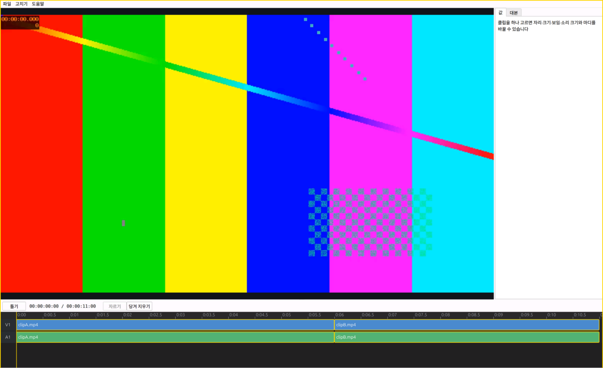

# VideoIyagi

A video editor with a timeline, scripts and fast export.

타임라인과 대본으로 편집하는 영상 편집기.

- Drop in clips and edit them on a video and audio timeline
- Cut, ripple-delete, adjust position, size, visibility and volume
- Script tab, GPU preview and export to mp4

- 영상을 넣고 영상·소리 타임라인에서 편집합니다
- 자르기, 당겨 지우기, 자리·크기·보임·소리 크기 바꾸기
- 대본 탭, GPU 미리 보기, mp4 내보내기

> Not released yet — downloads will appear under [Releases](../../releases) when it is ready.
> 아직 공개 전입니다. 준비되면 [Releases](../../releases)에 올라옵니다.

